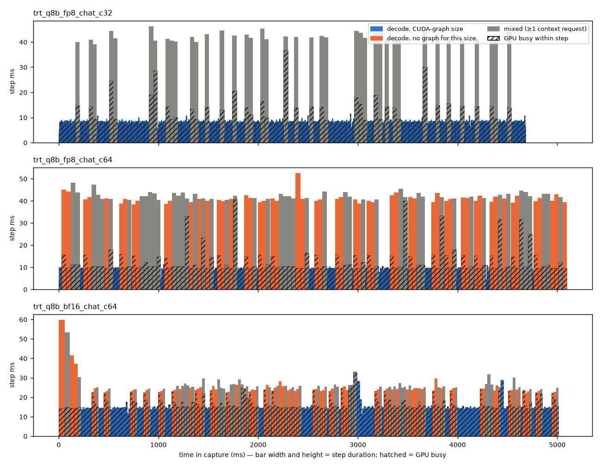

# LLM serving on one RTX PRO 6000 Blackwell (sm_120): vLLM vs SGLang vs TensorRT-LLM

*A pre-registered, reproducible benchmark. Each number is followed by the directory it comes from:
`S(server, workload, c)` means the row for that server, workload and concurrency in
`results/<plan>/summary/points.csv`, i.e. the median of three valid repetitions, computed by
`bib/summarize.py` from the raw per-request records in
`results/<plan>/<server>/<workload>/c<NNNN>/rep*/requests.jsonl.gz`. Unless stated, `<plan>` is `main`.
Generated tables: [`results/tables.md`](results/tables.md). Pre-registered comparisons with CIs:
[`results/comparisons/comparisons.md`](results/comparisons/comparisons.md). Protocol:
[`PREREGISTRATION.md`](PREREGISTRATION.md) (tag `prereg-v1`) and [`AMENDMENTS.md`](AMENDMENTS.md) (A1–A7).
Day-by-day record: [`LOG.md`](LOG.md).*

«DRAFT — items marked «…» are filled in when the last GPU runs finish.»

## 0. Conclusions

1. **Single-stream decode is bandwidth-bound, and the three frameworks are within 3 % of each other.**
   Qwen3-8B BF16 at concurrency 1: TPOT p50 SGLang 11.29 ms, vLLM 11.57 ms, TensorRT-LLM 11.65 ms against a
   9.48 ms floor (15.1 GB read per step ÷ 1597 GB/s), i.e. 81–84 % of the specified bandwidth
   (`S(*-q8b-bf16, chat, 1)`; P1, P6, P8b). The gap to the floor is a fixed cost per layer
   (≈ 50–85 µs × 36 or 64 layers), so it matters most for the smallest, fastest step (§3.1).
2. **The official block-wise FP8 checkpoints pay off in vLLM and SGLang, by less than the byte ratio.**
   8B decode TPOT ×0.61 (vLLM) / ×0.65 (SGLang) against a 0.54 byte ratio; 8k prefill TTFT ×0.73–0.74;
   peak chat throughput ×1.26–1.30; energy per output token ×0.71–0.78 (P2, P3, P4, P12). Quality on
   GSM8K is unchanged within noise (§3.8).
3. **TensorRT-LLM 1.2.1 runs the same FP8 checkpoint correctly (GSM8K 0.924) but slowly on sm_120.** Its c=1
   decode gains as much as the others (×0.65), but 8k prefill is 5 % *slower* than BF16 (512 vs 490 ms; P3
   refuted), and chat throughput stops scaling at 32 concurrent requests: TPOT doubles from 10.7 ms (c=32)
   to 21.9 ms (c=64), so its FP8 chat peak is half of its own BF16 peak (2525 vs 5002 tok/s; P4 refuted) and
   it spends 1.41× the energy per token (P12 refuted). Nsight Systems shows why (§5.1): with the
   `trtllm-serve` defaults only batch sizes 1–32, 64 and 128 have CUDA graphs and padding is off, so at
   c=64 more than half of all steps run eagerly, and an eager FP8 step is host-bound (≈ 37 ms to issue
   ≈ 600 launches while the GPU works ≈ 13 ms). Turning padding on (exploratory) lifts FP8 throughput to
   ≥ 2.2× its default peak. Its FP8 prefill GEMM on sm_120 is only ≈ 3 % faster than its BF16 GEMM.
4. **At high concurrency the frameworks differ much more than at c=1.** On 32B FP8 chat SGLang reaches
   3581 tok/s against vLLM 2629 and TensorRT-LLM 2646 (+36 %; my "within ±10 %" prediction P11 is refuted).
   At equal concurrency 256, SGLang's decode step is 19 % shorter (TPOT p50 74 vs 91 ms); Nsight Systems
   puts the difference in decode attention (174 vs 74 µs of GPU time per output token; GEMMs 191 vs 214 µs,
   §5.1). When the KV pool
   fills (c=512), vLLM keeps admitting requests and its TPOT doubles, SGLang queues them and its TTFT goes
   to 9.7 s — an admission policy choice, not a speed difference (§3.2).
5. **KV capacity, not compute, sets the ceiling for agent traffic — in every framework.** When
   sessions × context exceed the KV pool, prefix-cache hits fall from 0.85 to 0.42–0.47, history is
   recomputed and throughput halves: 8B BF16 at 64 → 128 sessions SGLang 699 → 391 and TensorRT-LLM
   720 → 378 tok/s; 32B FP8 at 32 → 64 sessions vLLM 243 → 124, SGLang 276 → 136, TensorRT-LLM 223 → 92 tok/s.
   Below that point prefix caching cuts agent TTFT 3.4–3.8× and raises throughput 2.7–3.0× (P10, §3.6).
6. **Long-prompt scheduling differs by design.** With 32 concurrent 8k prompts all three deliver the same
   throughput (223–235 tok/s), but vLLM and TensorRT-LLM start new prompts first (TTFT p50 1.8 s, TPOT 129 ms)
   while SGLang protects running decodes (TTFT 6.6 s, TPOT 85 ms) (§3.5).
7. **NVFP4 (Blackwell FP4) is the best 32B format here, in all three frameworks.** Versus FP8: decode
   TPOT ×0.62–0.68, 8k prefill TTFT ×0.45–0.69, peak chat throughput ×1.23–1.37 (vLLM, SGLang), KV pool
   +25–32 %, GSM8K within 0.8 points (P13 confirmed; §5.2). It took three toolchain fixes to get there.
8. **Measurement hygiene mattered.** The pre-registered checks exposed one protocol error of mine
   (TensorRT-LLM cache carry-over between repetitions, A2) and several measurement-code bugs (§7).
   Ten of 738 main runs are invalid, all TensorRT-LLM (bursty streaming, §6); none is used.

## 1. Question and setup

*What does each serving framework deliver on one workstation-class Blackwell GPU, where does the
time go, and which defaults matter?* Frameworks are run with their defaults; the few deviations that
the workloads required are listed in §6.

**Hardware.** One NVIDIA RTX PRO 6000 Blackwell **Server Edition** (GB202, sm_120, 96 GB GDDR7, 512-bit,
**1597 GB/s** per NVIDIA's product page; ECC off; 600 W limit) in an AutoDL container: 25 vCPU Xeon
Platinum 8470Q, 120 GB RAM, driver 595.71.05. Clocks cannot be locked inside the container; every run
records 10 Hz SM/memory clock, power, temperature and NVML clock-event reasons (`power.csv.gz`), and
every server config has a hardware/software fingerprint (`results/<plan>/fingerprints/<id>/`).

| Framework | Version | torch | Attention / FP8 GEMM path seen in the server logs |
|---|---|---|---|
| vLLM | 0.33.0 (V1 engine) | 2.14.0+cu130 | FLASH_ATTN backend; FP8: DeepGEMM block-scaled GEMM, JIT-compiled for `sm_120f` |
| SGLang | 0.5.23 | 2.14.1+cu130 | FlashInfer attention and sampling; FP8 block GEMM via DeepGEMM / Triton |
| TensorRT-LLM | 1.2.1, PyTorch backend (`trtllm-serve`) | 2.9.1+cu130 | TRT-LLM attention; FP8: `trtllm::fp8_block_scaling_gemm` |

Environments are locked with `uv` (`envs/<name>/uv.lock`); FP8 in vLLM and SGLang needed a CUDA 13.0
toolchain for DeepGEMM's JIT (`envs/README.md`, LOG 2026-11-08).

**Checkpoints** (ModelScope, pinned commits, SHA-256 verified, `models/*.json`): Qwen3-8B (BF16),
Qwen3-8B-FP8 and Qwen3-32B-FP8 (official 128×128 block-wise FP8 weights, dynamic activation scales),
Qwen3-32B-NVFP4 (NVIDIA ModelOpt, `nv-community/Qwen3-32B-NVFP4`).

**Workloads** — identical request files for every framework (SHA-256 in `data/requests/SHA256SUMS`,
regenerable with `python -m bib workloads`). Prompts are pre-rendered Qwen3 ChatML strings, verified
byte-identical to `apply_chat_template(enable_thinking=False)`; `ignore_eos` with `max_tokens` = target,
so every framework generates exactly the same number of tokens — checked per request.

| Workload | Input tokens | Output tokens | Notes |
|---|---|---|---|
| chat | ShareGPT V3, mean 115 | real reply length, mean 278 | `benchmark_serving` filters |
| prefill8k / 16k / 32k | 8000 / 16000 / 32000 | 128 | unique document per request |
| agent | mean 8187 (≤ 24k) | mean 136 | 512 synthetic tool-calling sessions, 4–12 turns, shared 2.8k-token system prompt; median 86 % of a prompt is the previous prompt |
| quality | GSM8K, 250 questions | ≤ 1024, natural EOS | greedy; accuracy compared across frameworks |

## 2. Method (summary; the binding text is PREREGISTRATION.md + AMENDMENTS.md)

* **Closed-loop load** (`bib/client.py`, asyncio + aiohttp, up to 6 processes): N workers, one request
  in flight each; agent sessions send their turns in order. Concurrency is swept upward (chat 1–512,
  prefill 1–32, agent 1–256 sessions). At each level: warm-up from a *separate* request file
  (discarded), then **3 repetitions** over the same request subset. Between repetitions the prefix
  cache is cleared (vLLM `/reset_prefix_cache`, SGLang `/flush_cache`); TensorRT-LLM has no reset
  endpoint, so it runs chat/prefill with KV-block reuse off (A4) and is restarted before every agent
  repetition (A2). The sweep stops at the knee (first level ≥ a workload minimum with < 5 % median
  throughput gain) or at the first error. `bib/runner.py` enforces all of this.
* **Metrics** from raw SSE timestamps: TTFT (first chunk with text), TPOT = (E2E − TTFT)/(n − 1), ITL,
  E2E (p50/p90/p99); output throughput; goodput under the pre-registered SLOs; energy per token from the
  NVML energy counter interpolated to the load window; peak memory; prefix-cache hit rate from
  `usage.prompt_tokens_details.cached_tokens` (A1).
* **Validity checks** (`bib/sanity.py`), any failure ⇒ run invalid and excluded:
  every request's TPOT ≥ 0.97 × bandwidth floor (floor = (checkpoint − input-embedding bytes) /
  1597 GB/s); server-reported token counts equal the request file; no errors; finish reason `length`;
  load generator < 90 % CPU; no unexpected prefix-cache hits on chat/prefill (A2); GSM8K accuracy not
  significantly below the best framework on the same checkpoint (≥ 5 points *and* McNemar p < 0.05).
  A post-hoc, burst-tolerant variant of the bandwidth check (A5) is computed separately and is not
  used for any conclusion.
* **Statistics**: ratio of geometric means of the three repetitions with a Welch-t 95 % CI on log values.
  "Better/worse" needs the CI to exclude 1 and a ≥ 5 % difference; "equivalent" needs the CI inside ±5 %.
  A prediction is *confirmed* if the CI lies in the predicted range, *refuted* if it lies entirely
  outside, otherwise *undecided*. CIs are not adjusted across the ~30 comparison rows; the regression
  study (§5.3) uses Benjamini–Hochberg. With three repetitions the CIs describe run-to-run noise on
  this one machine, not variation across machines.

## 3. Results

Headline table (generated, `results/tables.md`): peak output throughput (and the concurrency where it
occurred), c=1 latency and energy at peak, per workload and config.

«headline tables are pasted from results/tables.md in the final version»

### 3.1 Decode-bound regime (concurrency 1)

| Config | floor ms | vLLM TPOT | SGLang TPOT | TensorRT-LLM TPOT | achieved bandwidth |
|---|---|---|---|---|---|
| 8B BF16 (15.1 GB/step) | 9.48 | 11.57 | 11.29 | 11.65 | 81–84 % |
| 8B FP8 (8.2 GB/step) | 5.13 | 7.06 | 7.36 | 7.61 | 67–73 % |
| 32B FP8 (32.8 GB/step) | 20.52 | 25.11 | 25.55 | 26.03 | 79–82 % |

Source: `S(<fw>-q8b-bf16 | q8b-fp8 | q32b-fp8, chat, 1)`, floors from `server_info.json`
(`model_bytes.read_bytes_per_step`).

The excess over the floor is 1.8–2.5 ms per step for both 8B checkpoints and 4.6–5.5 ms for the 32B
(64 layers instead of 36): ≈ 50–85 µs per layer, roughly independent of weight bytes. That is what a
fixed per-layer cost would produce (kernel boundaries, norms, RoPE, attention over a short context,
sampling), and it explains why FP8 helps the 8B decode less than the 0.54 byte ratio: the bytes halve,
the fixed part does not (P2: measured 0.61 / 0.65 / 0.65; a pure-bandwidth model predicts 0.54, a
"bytes + 2.0 ms" model predicts 7.1 ms ≈ the vLLM value). Evidence: the three-checkpoint pattern above;
the per-layer attribution is an inference, not a kernel measurement.

### 3.2 Throughput scaling and the knee

Batched decode re-uses each weight read for every running request, so throughput grows almost
linearly until per-step cost rises: vLLM 8B BF16 goes from 86 tok/s (c=1) to 5388 tok/s (c=128) while
TPOT only rises 11.6 → 20.6 ms; from c=256 to 512 throughput gains 3.5 % (6825 → 7067) while TPOT
doubles (33.9 → 65.4 ms) — the knee (`S(vllm-q8b-bf16, chat, *)`).

| Peak chat tok/s (c) | vLLM | SGLang | TensorRT-LLM |
|---|---|---|---|
| 8B BF16 | 7067 (512) | 7328 (512) | 5002 (128)† |
| 8B FP8 | 8837 (512) | 9523 (512) | 2525 (32) |
| 32B FP8 | 2629 (256) | 3581 (512) | 2646 (512) |

† TensorRT-LLM 8B BF16 c=256 and c=512 were measured but are invalid under the strict bandwidth rule
(§6), so its peak is unknown; P8a is therefore *inconclusive* (A7), not refuted.

* **SGLang vs vLLM**, 8B BF16: +4 % at peak (P5, CI [+2 %, +6 %]; prediction "within ±10 %" confirmed).
  32B FP8: +36 % (P11 refuted). At c=256, where neither KV pool is full (256 × ≈ 400 tokens ≈ 100k of
  ≈ 200k), SGLang's TPOT is 74.2 ms against vLLM's 91.4 ms (`S(*-q32b-fp8, chat, 256)`). Nsight Systems
  attributes this to decode attention: vLLM's FlashAttention-2 split-KV kernel takes 174 µs of GPU time per
  output token, SGLang's FlashInfer kernel 74 µs, while the FP8 GEMMs take 191 vs 214 µs (§5.1c).
* **At c=512 on 32B the KV pool is the limit** and the frameworks handle it differently: vLLM admits all
  requests (TTFT p50 0.69 s) and its TPOT doubles to 187 ms, so throughput falls slightly
  (2629 → 2602 tok/s); SGLang holds requests in its queue (TTFT p50 9.7 s, TPOT 97 ms) and still gains
  14 % (3149 → 3581). Neither point is useful under the pre-registered chat SLO (TTFT ≤ 1 s and
  TPOT ≤ 50 ms): goodput peaks at c=128 (SGLang 1338, vLLM 1011 tok/s; SLO attainment 0.55 / 0.44) and
  is ≈ 0 at c=512 (SGLang 0, vLLM 10 tok/s) (`goodput_tok_s`, `slo_attainment` in the same rows).
  Peak throughput and goodput pick different operating points.
* **TensorRT-LLM** tracks vLLM up to c=128 on 8B BF16 (c=128: 5002 vs 5388 tok/s), then its streaming
  becomes bursty (§6). On 8B FP8 it stops scaling at c=32 (§0.3, §5.1).

### 3.3 KV capacity (defaults, same 96 GB card)

| KV pool, tokens | vLLM (`gpu_memory_utilization` 0.92) | SGLang (`mem_fraction_static` auto) | TensorRT-LLM (`free_gpu_memory_fraction` 0.9) |
|---|---|---|---|
| 8B BF16 | 501,296 | 477,443 | 504,160 |
| 8B FP8 | 548,064 | 524,533 | 540,000 |
| 32B FP8 | 210,752 | 199,857 | 199,936 |

Source: `results/main/<server>/server_info.json` (`kv_capacity`, parsed from the server logs).
Qwen3-8B stores 144 KiB of BF16 KV per token (2 × 36 layers × 8 KV heads × 128 × 2 B), Qwen3-32B
256 KiB. FP8 weights free ≈ 7 GB on 8B, i.e. +9–10 % KV tokens. The defaults differ by ≈ 5 %, so the
pool size is a model/precision property here, not a framework one — which is why all three hit the
agent cliff at the same session count (§3.6).

### 3.4 FP8 vs BF16 (8B)

| | vLLM | SGLang | TensorRT-LLM |
|---|---|---|---|
| c=1 TPOT ratio (P2) | 0.609 [0.606, 0.612] | 0.652 [0.652, 0.652] | 0.653 [0.652, 0.653] |
| 8k c=1 TTFT ratio (P3) | 0.737 [0.734, 0.740] | 0.727 [0.719, 0.734] | **1.049 [1.031, 1.068]** |
| peak chat throughput (P4) | 1.255 [1.234, 1.277] | 1.297 [1.288, 1.306] | **0.508 [0.491, 0.525]** (FP8 c=32 vs BF16 c=128) |
| J/output token at peak (P12) | 0.784 [0.776, 0.792] | 0.713 [0.709, 0.717] | **1.411 [1.395, 1.426]** |
| peak agent throughput (sessions) | 596 (64) → 727 (32) | 699 (64) → 860 (64) | 720 (64) → 732 (64) |
| GSM8K (BF16 → FP8) | 0.928 → 0.936 | 0.936 → 0.936 | 0.940 → 0.924 |

Prefill speeds up less than the GEMM peak ratio (2×) because attention stays BF16 and block scaling
adds work; at 32k, where attention is a larger share, the gain shrinks further (vLLM 2498 → 2039 ms,
×0.82; SGLang 2361 → 1870 ms, ×0.79; `S(*-q8b-*, prefill32k, 1)`). TensorRT-LLM gets no prefill gain at
any length (8k 490 → 512, 16k 1093 → 1150, 32k 2883 → 3022 ms) — its FP8 path is examined in §5.1.

### 3.5 Long-context prefill and scheduling policy

c=1 TTFT p50, ms (`S(*, prefill8k|16k|32k, 1)`):

| | 8k | 16k | 32k |
|---|---|---|---|
| vLLM 8B BF16 | 466 | 1009 | 2498 |
| SGLang 8B BF16 | 448 | 990 | 2361 |
| TensorRT-LLM 8B BF16 | 490 | 1093 | 2883 |
| vLLM 32B FP8 | 1173 | 2734 | – (not in plan) |
| SGLang 32B FP8 | 1180 | 2719 | – |
| TensorRT-LLM 32B FP8 | 1900 | 4397 | – |

* 4× the tokens costs 5.4× the time (vLLM 8k → 32k): the causal-attention term grows quadratically
  (≈ 2.4 of 16.3 GFLOP per token at 8k, ≈ 9.4 of 23.3 at 32k for Qwen3-8B).
* 8k on 8B BF16 is ≈ 130 TFLOP of work; 466 ms ⇒ ≈ 280 TFLOPS sustained.
* TensorRT-LLM is 9–22 % slower than SGLang on 8B BF16 prefill and 62 % slower than vLLM on the 32B FP8
  8k prompt (1900 vs 1173 ms), where no chunking is involved (8000 < 8192).
* **Scheduling** under load (8k, c=32): throughput is the same (vLLM 226, TRT-LLM 223, SGLang 235 tok/s)
  but vLLM/TRT-LLM give TTFT p50 1.83/1.85 s with TPOT p50 129 ms, SGLang 6.61 s with 85 ms
  (`S(*-q8b-bf16, prefill8k, 32)`). vLLM's scheduler fills each 8192-token step with new prefill
  chunks alongside running decodes; SGLang lets running requests decode with fewer interleaved prefill
  chunks. The policy explanation is from the frameworks' documented defaults and the TTFT/TPOT pattern,
  not from a trace.

### 3.6 Agent trajectories and prefix caching (task 4.5)

Agent sessions re-send their whole history every turn; 84–86 % of prompt tokens hit the cache in every
framework while the pool is large enough (`prefix_cache_hit_rate` in `S(*, agent, *)`).

| 8B BF16, agent | TTFT p50 c=1 | TTFT p50 c=16 | peak tok/s (c) |
|---|---|---|---|
| vLLM, cache on | 133 ms | 190 ms | 596 (64) |
| vLLM, cache off | 379 ms | 647 ms | 222 (32) |
| SGLang, cache on | 110 ms | 164 ms | 699 (64) |
| SGLang, cache off | 373 ms | 630 ms | 246 (128) |
| TensorRT-LLM, cache on | 117 ms | 183 ms | 720 (64) |
| TensorRT-LLM, cache off | 398 ms | 629 ms | 239 (128) |

Sources: `S(*-q8b-bf16, agent, *)` and `results/prefix_cache/summary/points.csv`.
Cache on vs off at 16 sessions: TTFT ×0.30 (vLLM) / ×0.26 (SGLang) / ×0.29 (TensorRT-LLM); peak
throughput ×2.69 / ×2.84 / ×3.02 (P10a/b confirmed for all three). The 3.4–3.8× TTFT gain is below the ≈ 7× a pure token count would give (only
14–16 % of tokens are computed with the cache), because the remaining TTFT includes the decode steps of
other sessions that the new prefill chunk shares the GPU with.

**The KV cliff.** Apart from the shared 2.8k-token system prompt, a request carries on average
≈ 5.3k session-specific tokens (8187 − 2839). In a closed loop every session is always active, so the
cache must hold ≈ 5.3k × sessions tokens: 32 sessions ≈ 0.17M, 64 ≈ 0.34M, 128 ≈ 0.69M. That fits the
8B pools (≈ 0.48–0.50M) up to 64 sessions and the 32B pools (≈ 0.20M) up to 32 — exactly where every
framework's cliff is (8B: between 64 and 128 sessions; 32B: between 32 and 64). Past it, a session's
blocks are evicted before its next turn, the hit rate falls to 0.42–0.47, history is recomputed, TTFT
p50 jumps to 12 s (SGLang 8B, c=128) and throughput halves. The arithmetic is a back-of-envelope
model; the hit-rate collapse is measured. vLLM 8B BF16 had
already stopped at c=64 by the knee rule (596 vs 590 tok/s at c=32), so its 128-session point was not
run. SGLang is fastest below the cliff (P9: TTFT −14 % at 16 sessions; peak 699 vs 596 tok/s); its
radix cache with cache-aware scheduling is the plausible reason, not separately verified.

### 3.7 Energy

Energy per output token at each config's chat peak (J, `j_per_output_token`): 8B BF16 SGLang 0.066,
vLLM 0.078, TensorRT-LLM 0.086 (c=128); 8B FP8 SGLang 0.047, vLLM 0.062, TensorRT-LLM 0.121 (c=32);
32B FP8 SGLang 0.157, TensorRT-LLM 0.211, vLLM 0.216. Board power changes much less than throughput
(vLLM 8B BF16: 369 W decode-only at c=1, 418 W for 8k prefill at c=1, 499 W at 32k), so J/token is
mostly the inverse of throughput: batching is the dominant energy lever, FP8 the second (−22 to −29 %,
P12). Energy is the NVML counter interpolated to the load window; it agrees with the integral of the
10 Hz power series within 0.14 % on the runs checked (LOG 2026-11-08).

### 3.8 Output quality

GSM8K accuracy (250 questions, greedy) per config, all within noise of the best on the same checkpoint
(McNemar p ≥ 0.25): 8B BF16 0.928 / 0.936 / 0.940 (vLLM / SGLang / TRT-LLM), 8B FP8 0.936 / 0.936 / 0.924,
32B FP8 0.968 / 0.960 / 0.968 (`results/main/summary/quality.json`). No config failed the quality check.

## 4. Pre-registered comparisons (task 4.4)

Full table with sources: [`results/comparisons/comparisons.md`](results/comparisons/comparisons.md).
"Evidence" says whether the explanation was tested here.

| # | Result (ratio A/B, 95 % CI) | Prediction | Explanation | Evidence |
|---|---|---|---|---|
| P1 | TPOT/floor 1.221 (vLLM), 1.191 (SGLang), 1.229 (TRT) | confirmed ×3 | bandwidth-bound weight streaming + fixed per-layer cost | three-checkpoint pattern (§3.1) |
| P2 | FP8/BF16 c=1 TPOT 0.609 / 0.652 / 0.653 | confirmed ×3 | bytes 0.54× + unchanged fixed cost | consistent with §3.1 model |
| P3 | FP8/BF16 8k TTFT 0.737 / 0.727 / 1.049 | confirmed ×2, **refuted** (TRT) | GEMMs faster, attention BF16; TRT's FP8 GEMM path is slow on sm_120 | 32k shrinks the gain (§3.4); TRT: §5.1 |
| P4 | FP8/BF16 peak chat 1.255 / 1.297 / 0.508 | confirmed ×2, **refuted** (TRT) | less weight traffic, more KV; TRT stops scaling at c=32 | TRT: §5.1 |
| P5 | SGLang/vLLM peak chat 8B BF16 1.042 [1.021, 1.063] | confirmed | same kernel families | – |
| P6 | SGLang/vLLM c=1 TPOT 0.976 [0.975, 0.976] | confirmed (equivalent) | both bandwidth-bound | – |
| P7 | SGLang/vLLM 32k TTFT 0.946 [0.941, 0.952] | confirmed | compute-bound, similar attention kernels | – |
| P8a | TRT/vLLM peak chat 8B BF16: censored | inconclusive (A7) | TRT c ≥ 256 invalid (bursts) | §6 |
| P8b | TRT/vLLM c=1 TPOT 1.007 [1.007, 1.008] | confirmed (equivalent) | bandwidth-bound | – |
| P9 | SGLang/vLLM agent TTFT c=16 0.863 [0.843, 0.884] | confirmed | radix cache + cache-aware scheduling | not isolated |
| P10a | cache on/off TTFT c=16: 0.296 / 0.260 / 0.294 | confirmed ×3 | 84–86 % of tokens cached | hit rate measured |
| P10b | cache on/off peak: 2.687 / 2.838 / 3.016 | confirmed ×3 | prefill work ÷ 6 | hit rate measured |
| P11 | SGLang/vLLM peak chat 32B FP8 1.362 [1.356, 1.369] | **refuted** | faster decode attention (FlashInfer vs FlashAttention-2 split-KV) + queueing at the KV limit | nsys: attention 74 vs 174 µs/token (§5.1c) |
| P12 | FP8/BF16 J/token at peak 0.784 / 0.713 / 1.411 | confirmed ×2, **refuted** (TRT) | fewer bytes per token at similar power; TRT's FP8 peak is at c=32 | power series |
| P13 | NVFP4/FP8 32B c=1 TPOT 0.684 / 0.638 / 0.617; GSM8K Δ −0.8 / −0.4 / 0.0 points | confirmed ×3 | 0.58× bytes + fixed per-layer cost; FP4 near-lossless here | §5.2 |

## 5. Deep dives

### 5.1 Nsight Systems: what limits TensorRT-LLM FP8, and why SGLang decodes 32B faster than vLLM

**How.** `tools/nsys_profile.py` starts the server under `nsys launch` (CUDA + NVTX + OS-runtime trace,
CUDA-graph nodes traced), applies the same warm-up and load as the benchmark, and captures only a
steady-state window (`nsys start/stop`). Captures, kernel summaries, request records and the analysis
outputs are in `results/nsys/` (large `.nsys-rep`/`.sqlite` files stay on the instance, see
`results/nsys/README.md`). Under the profiler the anomalies reproduce: TensorRT-LLM 8B FP8 TPOT 10.9 ms at
c=32 vs 24.3 ms at c=64 (21.9 ms without the profiler); 32B FP8 c=256 TPOT vLLM 87.8 ms vs SGLang 73.0 ms
(`*_info.json`).

**(a) TensorRT-LLM FP8 stops scaling at 32 concurrent requests because most steps fall off its CUDA graphs.**
TensorRT-LLM names every executor iteration in an NVTX range (`_forward_step N: c ctx reqs, g gen reqs`), so
each step can be classified (`tools/nsys_trt_steps.py` → `results/nsys/analysis/trt_steps.md`):

| TRT-LLM 8B, chat | step class | share of steps | step time | host time in step | GPU busy in step | launches / step |
|---|---|---|---|---|---|---|
| FP8, c=32 | decode, batch ≤ 32 (CUDA graph) | 90 % | 8.3 ms | 0.9 ms | 8.0 ms | 2 |
| FP8, c=32 | mixed (a new prompt in the batch) | 10 % | 42.2 ms | 38.4 ms | 15.0 ms | 631 |
| FP8, c=64 | decode, batch = 64 (CUDA graph) | 45 % | 8.8 ms | 1.0 ms | 8.3 ms | 2 |
| FP8, c=64 | decode, batch 33–63 (no graph) | 29 % | 41.1 ms | 36.1 ms | 11.9 ms | 523 |
| FP8, c=64 | mixed | 26 % | 42.5 ms | 37.9 ms | 14.9 ms | 631 |
| BF16, c=64 | decode, batch = 64 (CUDA graph) | 47 % | 13.2 ms | 1.0 ms | 12.8 ms | 2 |
| BF16, c=64 | decode, batch 33–63 (no graph) | 31 % | 24.9 ms | 20.3 ms | 18.0 ms | 451 |
| BF16, c=64 | mixed | 22 % | 26.7 ms | 22.0 ms | 17.1 ms | 562 |

* With the `trtllm-serve` defaults, TensorRT-LLM 1.2.1 captures generation-only CUDA graphs for batch sizes
  1–31, 32, 64 and 128 with `cuda_graph_config.enable_padding = false` (server log; `CudaGraphConfig` in
  `tensorrt_llm/llmapi/llm_args.py`). At c=32 every decode-only step has a graph. At c=64 the decode batch is
  exactly 64 only 45 % of the time; batches of 33–63 and every step that contains a new prompt run eagerly.
* An eager FP8 step spends ≈ 36–38 ms on the host issuing 520–630 kernel launches — per-token
  activation-quantization kernels plus a host-side TMA descriptor encode for every block-scale GEMM launch
  (`cuTensorMapEncodeTiled`, 75 k calls in the 5 s c=64 window, `*_cuda_api_sum.csv`) — while the GPU works
  12–15 ms. The mean step becomes 26.8 ms with the GPU busy 41 % of the time, so throughput falls even
  though a batch-64 graph step (8.8 ms) costs barely more than a batch-32 one (8.3 ms). BF16 has the same
  graph gaps, but its eager steps cost 25–27 ms, which is why BF16 still scales to c=128.
* **Intervention (exploratory, post hoc, `plans/explore_trt_cudagraph.yaml`)**: same server with
  `cuda_graph_config.enable_padding: true` (batches rounded up to the next captured size — the setting
  NVIDIA's own `trtllm-bench` uses). Chat c=64 TPOT 21.9 → 12.3 ms and throughput 2440 → 4095 tok/s
  (strict-valid repetition; A5 median 4008); c=256 reaches 5553 tok/s with two strict-valid repetitions
  (A5: c=128 6787 tok/s), i.e. ≥ 2.2× the default FP8 peak; GSM8K unchanged (0.924)
  (`results/explore_trt_cudagraph/summary*/points.csv`). The padded runs trip the burst check more often
  (7 of 12 strict-invalid, all A5-valid), so these numbers are reported only here, labelled exploratory.
  **Conclusion: the collapse is a default-configuration effect (graph coverage × host cost of eager FP8
  steps), not a GPU-kernel limit.**
* Contrast (`results/nsys/analysis/decode_8b_fp8_c32_c64.md`): vLLM FP8, which pads decode batches up to
  its captured CUDA-graph sizes, keeps the GPU 88–89 % busy at both c=32 and c=64, while TensorRT-LLM drops
  from 75 % to 41 %. Per output token TensorRT-LLM's kernels need *less* GPU time than vLLM's at c=64
  (169 vs 197 µs) — the GPU work is efficient; it is the idle time between eager steps that costs.

**(b) TensorRT-LLM FP8 prefill is not faster than BF16 because its sm_120 block-scale GEMM is barely
faster than the BF16 GEMM.** Single 8k prefill at c=1, GPU time by category (`tools/nsys_prefill.py` →
`results/nsys/analysis/prefill_breakdown.md`; cross-checked against the NVTX attribution, identical):

| 8B, one 8k prefill (c=1) | GPU time | linear-layer GEMMs | activation quant | attention | other | GEMM throughput (111 TFLOP of linear work) |
|---|---|---|---|---|---|---|
| TensorRT-LLM BF16 | 410 ms | 291 ms (BF16, CUTLASS/cuBLAS) | – | 97 ms (`fmha_v2`) | 21 ms | ≈ 382 TFLOPS |
| TensorRT-LLM FP8 | 438 ms | 282 ms (`sm120_blockscaled_gemm`) | 36 ms | 97 ms | 21 ms | ≈ 395 TFLOPS |
| vLLM FP8 | 267 ms | 158 ms (DeepGEMM `sm120_fp8_fp4_gemm`) | 34 ms | 70 ms (FlashAttention-2) | 4 ms | ≈ 705 TFLOPS |

TensorRT-LLM's sm_120 block-scale FP8 GEMM runs at the speed of its BF16 GEMM (395 vs 382 TFLOPS), so FP8
saves nothing on the GEMMs and adds 36 ms of activation quantization: FP8 prefill ends up 7 % slower on the
GPU (5 % in TTFT). vLLM's DeepGEMM kernel reaches ≈ 705 TFLOPS on the same shapes — 1.8× TensorRT-LLM's —
which is where vLLM's FP8 prefill gain (×0.74, P3) comes from. With the NVFP4 checkpoint TensorRT-LLM's
prefill is as fast as the others (§5.2), so its prefill path is fine; the slow piece is specifically the
FP8 block-scale GEMM kernel on sm_120 in this release. (TFLOPS = 2 × 6.95 B linear parameters × 8000
tokens ÷ GEMM time; lm_head runs on the last token only.)

**(c) SGLang decodes 32B FP8 faster than vLLM at c=256 because of decode attention, not GEMMs.** Both GPUs
are ~99 % busy, so GPU time per generated token = 1/throughput, split by each category's share of kernel
time (`tools/nsys_decode_compare.py` → `results/nsys/analysis/decode_32b_c256.md`; per-step times are not
comparable because SGLang runs prefill as separate steps):

| 32B FP8, chat c=256 | output tok/s (benchmark) | GPU µs / output token | attention | FP8 GEMMs (+split-K reduce) | lm_head (BF16) | other |
|---|---|---|---|---|---|---|
| vLLM (FlashAttention-2 split-KV, DeepGEMM) | 2629 | 378 | **174** (46 %) | 191 (51 %) | 5 | 7 |
| SGLang (FlashInfer paged, CUTLASS FP8) | 3149 | 313 | **74** (24 %) | 214 (68 %) | 7 | 18 |

SGLang spends 100 µs less per token in attention and 23 µs more in GEMMs; the net 65 µs (−17 %) matches its
19 % shorter TPOT and 20 % higher throughput at this load. At c=256 the KV cache read per decode step is of
the same order as the 32.8 GB of weights (≈ 256 sequences × a few hundred tokens × 256 KiB), so the
attention kernel's efficiency matters as much as the GEMMs'. Why vLLM's FlashAttention-2 split-KV kernel
is 2.4× slower per token on sm_120 (e.g. how it handles 8 query heads per KV head) was not examined at the
kernel level (no Nsight Compute); a FlashInfer attention backend for vLLM is the obvious untested
experiment.

### 5.2 NVFP4 vs FP8 (32B, task 5.2)

Same workloads (chat, prefill8k) and request files as the 32B FP8 configs of `main`; NVFP4 checkpoint
`nv-community/Qwen3-32B-NVFP4` (ModelOpt, FP4 weights and activations with FP8 block scales, lm_head
BF16); **KV cache BF16 in all six configs** (A3, A9). All three frameworks ran it on sm_120 — after
three build/config fixes (A8: FlashInfer JIT OOM and missing cuBLAS headers; A9: TensorRT-LLM rejects
a BF16 KV override, solved with a config overlay of the same weights).

| 32B | vLLM FP8 → NVFP4 | SGLang FP8 → NVFP4 | TensorRT-LLM FP8 → NVFP4 |
|---|---|---|---|
| bytes read per decode step | 32.8 → 19.1 GB (×0.58) | same | same |
| c=1 TPOT p50 (P13) | 25.11 → 17.18 ms, **×0.684** | 25.55 → 16.30 ms, **×0.638** | 26.03 → 16.06 ms, **×0.617** |
| 8k c=1 TTFT p50 | 1173 → 747 ms (×0.64) | 1180 → 812 ms (×0.69) | 1900 → 862 ms (**×0.45**) |
| peak chat tok/s (c) | 2629 (256) → 3611 (256), ×1.37 | 3581 (512) → 4398 (256), ×1.23 | 2646 (512) → 2342 (128)† |
| peak 8k-prefill tok/s (c) | 86 (32) → 125 (32) | 90 (32) → 126 (32) | 59 (32) → 123 (32) |
| J/output token at chat peak | 0.216 → 0.149 | 0.157 → 0.111 | 0.211 → 0.137 (c=128)† |
| KV pool, tokens | 210,752 → 262,512 | 199,857 → 250,849 | 199,936 → 264,224 |
| GSM8K (paired, 250) | 0.968 → 0.960 (p = 0.63) | 0.960 → 0.956 (p = 1) | 0.968 → 0.968 (p = 1) |

Sources: `results/nvfp4/summary/points.csv`, `results/main/summary/points.csv` (`*-q32b-*`),
`results/comparisons/comparisons.md` (P13), `results/nvfp4/QUALITY_FP8_vs_NVFP4.md`
(`tools/quality_pair.py`), `server_info.json` of each server. † TensorRT-LLM NVFP4 chat c=256 and c=512
are invalid under the strict rule (bursty streaming, 0.05–0.15 % of requests; all six pass A5), so its
peak is censored at c=128 (A7).

* **P13 confirmed for all three frameworks**: decode TPOT ×0.62–0.68 against a 0.58 byte ratio, the
  same "bytes + fixed per-layer cost" pattern as FP8 vs BF16 (§3.1); accuracy drop ≤ 0.8 points
  (pre-registered bound: 3 points), no McNemar difference.
* Prefill gains more than decode (×0.45–0.69): the FP4 tensor-core GEMMs are faster, and attention stays
  BF16. **TensorRT-LLM's NVFP4 prefill is as fast as the others (862 vs 747–812 ms) although its FP8
  prefill was 62 % slower** — evidence that TensorRT-LLM's problem in §0.3/§5.1 is its FP8 block-scale
  GEMM path on sm_120, not its prefill pipeline in general.
* Throughput gains (×1.23–1.37 at peak) come from shorter decode steps *and* a 25–32 % larger KV pool
  (the 13.7 GB of freed weight memory); peak memory use is unchanged (≈ 87–91 GB, the pools fill it).
* On this GPU, NVFP4 is the better 32B format on every measured axis; the cost is a more fragile
  toolchain (two of three frameworks needed JIT-build fixes).

### 5.3 Regression detection: vLLM 0.32.0 → 0.33.0 (task 5.3)

Same 8B BF16 configs (chat c=1/16/64/256, prefill8k c=1/8, agent c=16), same request files, both
versions in their own locked environments (`plans/regression.yaml`). `bib/regress.py` tests each
config × metric (Welch-t CI on the log ratio, Benjamini–Hochberg FDR 5 %, practical threshold 5 %).
Of 49 tests one is a regression with confidence 0.986: chat c=1 TTFT p50 35.9 → 37.6 ms (+6.4 %,
CI [+2.4 %, +10.6 %]); 37 are "no change" (e.g. c=1 TPOT +0.4 %), 11 inconclusive
(`results/regression/REGRESSION_REPORT.md`). GitHub Actions re-runs the detector on the committed
results on every push (`.github/workflows/ci.yml`), CPU-only.

## 6. Validity, amendments and what was excluded

* **Invalid runs (strict rule)**: 10 of 738 in `results/main`, all TensorRT-LLM, all `bandwidth_bound`:
  8B BF16 chat c=64 (2 of 3 reps), c=256 (3), c=512 (3); 32B FP8 chat c=256 (1 of 3); 8B FP8
  prefill32k c=1 (1 of 3). In each, a few requests (0.05–6 %) received many tokens in one burst after a
  stall, so their client-side TPOT is below the physical floor — e.g. `prefill32k-0008`: first token
  ≈ 500 ms later than its neighbours, then ≈ 45 tokens 0.3 ms apart, at concurrency 1. A client timing
  error would shift all requests, and vLLM/SGLang at the same load never trip the check. They are
  excluded from every number in this report. The post-hoc A5 variant (≤ 1 % violators and p10
  TPOT/floor ≥ 0.97) would accept nine of the ten; it is reported in `results/main/summary_a5/` only for
  transparency.
* **Amendments** (AMENDMENTS.md): A1 report cached prompt tokens; A2 TensorRT-LLM restart per
  repetition + new "no unexpected cache hits" check (after my protocol error, §7); A3 KV-cache dtype
  flags for NVFP4; A4 TensorRT-LLM KV-block reuse off on chat/prefill instead of restarts; A5
  burst-tolerant variant (post hoc, secondary); A6 TensorRT-LLM chunked prefill for prompts > 8192
  tokens (otherwise HTTP 400); A7 censored peaks reported as inconclusive (post hoc).
* **Superseded runs** (kept, not used): `results/_superseded/` — TensorRT-LLM runs with cache
  carry-over (A2) and the failed attempts without chunked prefill (A6).
* **TensorRT-LLM on sm_120 (task 4.3)** worked, but needed: `HWLOC_COMPONENTS=-gl` (OpenMPI's hwloc
  probed an X display and hung at import); retries for an intermittent segfault during start-up in
  `nvmlSystemGetConfComputeSettings` (11 failed starts in total, each followed by a successful retry;
  `results/main/trtllm-*/start_failures.jsonl`); A4 and A6 above.

## 7. Where the agent got it wrong

Every item is a mistake by the coding agent (Claude) that wrote this project, with how it was
caught. A benchmark is only as credible as its error-correction loop.

| # | Mistake | Effect if uncaught | Caught by | Fix |
|---|---|---|---|---|
| 1 | **Protocol error:** pre-registered that TensorRT-LLM needs no cache reset on chat/prefill "because prompts are unique", forgetting that every repetition replays the same subset | TRT 8k prefill TTFT 4–5× too good (497 → 104 ms on rep 2) | physical implausibility (8000 tokens in 132 ms at c=2) and per-request `cached_tokens` = whole prompt | A2: restart per rep; new `no_unexpected_cache_hits` check; runs moved to `_superseded/` |
| 2 | Pre-registration did not anticipate TensorRT-LLM's `max_num_tokens` = 8192 without chunked prefill | 16k/32k/agent unrunnable (HTTP 400) | runner errors | A6 |
| 3 | Client gave the "keep output text" budget to one of 32 workers | GSM8K accuracy 0.032 → every config "fails" quality | implausible accuracy | shared budget; quality re-run (0.928) |
| 4 | Client returned results through a `multiprocessing.Pipe` read by the same process | hang at concurrency ≥ 32 | end-to-end test against the mock server | in-process return |
| 5 | Energy window demanded power samples past the last stream end | silent fallback to a coarser window (+1 % energy) | `energy_source` field in the first real run | bounded extrapolation; cross-check vs ∫P dt |
| 6 | Shell secret scanner did not look inside `.gz` on macOS | third-party credentials embedded in public ShareGPT text were committed inside request files | rewrote the scanner in Python (scans gz everywhere) | request files untracked, regenerated from the manifest; history rewritten «…» |
| 7 | Resume restarted server-log numbering at 01 | overwrote one TensorRT-LLM start-failure log | noticed while reading logs | numbering continues; error line survives in `start_failures.jsonl` |
| 8 | `tools/sync.sh push` used `git reset --hard` after results became tracked | would have replaced the live runner log on the GPU | read the script before running it | reset only code paths |
| 9 | Relative `--extra_llm_api_options` path, server cwd = result dir | TRT could not start | smoke test | absolute path |
| 10 | Smoke-request exception path did not stop the server | orphaned server; next start "succeeded" against it | mock pipeline test | try/finally |
| 11 | uv copied instead of hard-linking on overlayfs | system disk 86 % full, ENOSPC during TRT env build | disk check, link count 1 | `UV_LINK_MODE=hardlink` |
| 12 | ModelScope `/resolve/` URLs returned LFS pointer files | 0.1 KB "weights" | SHA-256 verification in the fetcher | API download URL |
| 13 | NVFP4 KV-dtype flag for TensorRT-LLM (A3) written without checking accepted values; start retries did not distinguish a deterministic error from the intermittent segfault | 4 wasted starts; with `auto` an FP8 KV cache would have broken the like-for-like design | server log `ValueError … Accepted types are ('fp8', 'nvfp4', 'auto')` | A9 config overlay |
| 14 | Minimal CUDA 13.0 toolchain lacked cuBLAS headers; adding cuBLAS silently pulled a mismatched NVRTC 13.5 | SGLang NVFP4 could not build its FP4 kernels | build error `cublasLt.h: No such file`; reading the install output | cuBLAS + NVRTC 13.0.88 pinned in the lock (A8) |

## 8. Limitations and honesty statement

* **Single GPU, one rented instance.** All results depend on this AutoDL instance's state (clocks that
  cannot be locked, host co-tenants, driver 595.71.05, container limits). Repetitions measure noise on
  this machine only; other RTX PRO 6000 boards (e.g. the Workstation Edition, 1792 GB/s) will differ.
* **Defaults, not tuned.** Each framework runs with its defaults; a tuned configuration (e.g.
  TensorRT-LLM CUDA-graph batch sizes or a larger `max_num_tokens`) could change several rankings.
* **Synthetic agent workload**, pre-rendered prompts (servers' chat-template code is not exercised),
  `ignore_eos` lengths, closed-loop load only (no open-loop arrival process).
* **Three repetitions** per point; CIs are not adjusted across comparisons except in §5.3.
* **Who did what.** The code, the runs and this report were produced mainly by a coding agent
  (Claude, Anthropic). Rui Huang defined the project, made the decisions (budget, scope, instance
  policy) and is responsible for accepting the results.
